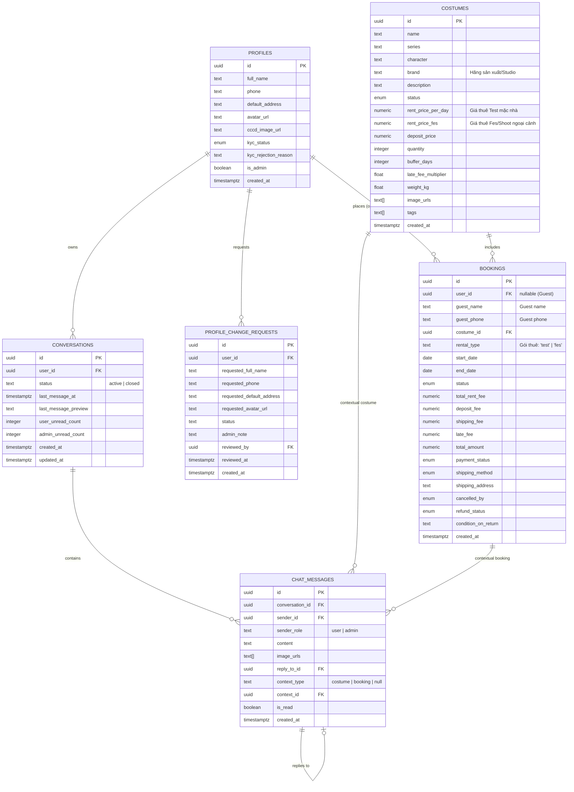
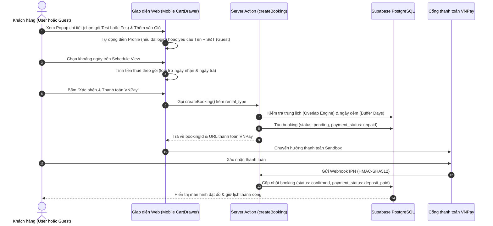
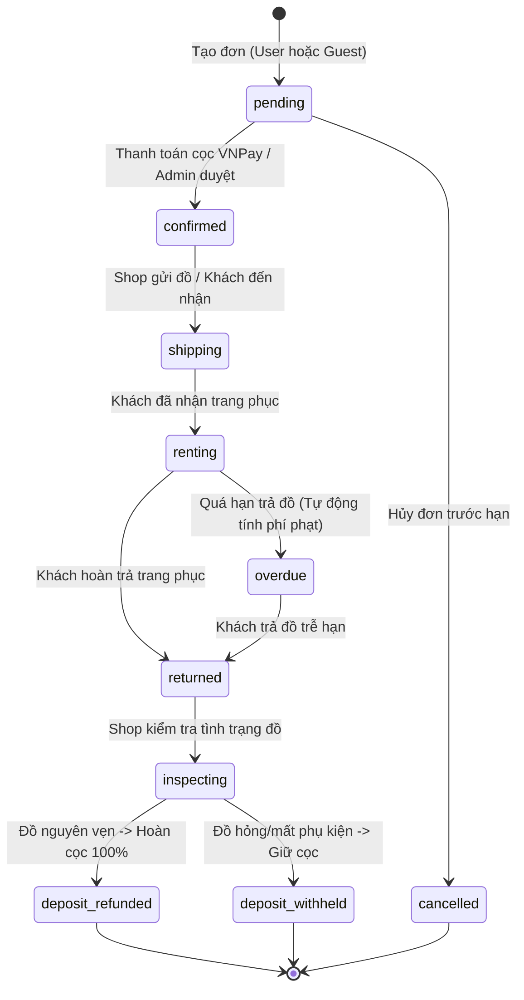

# 🌸 TÀI LIỆU TOÀN DIỆN VỀ THIẾT KẾ & NGHIỆP VỤ HỆ THỐNG
# COSPLAY RENTAL WEB APP (COSRENT)

> **DUY NHẤT & CHÍNH THỨC (SINGLE SOURCE OF TRUTH):**
> Toàn bộ nghiệp vụ, kiến trúc công nghệ, mô hình dữ liệu (ERD), giao diện người dùng (UI/UX), luồng nghiệp vụ (User Flows), hướng dẫn cài đặt và lịch sử cập nhật của dự án Cosplay Rental Web App được hợp nhất và duy trì duy nhất tại tài liệu này.

---

## MỤC LỤC
1. [Tổng Quan Sản Phẩm & Mục Tiêu (Product Overview & Goals)](#1-tổng-quan-sản-phẩm--mục-tiêu)
2. [Đối Tượng Người Dùng & Chân Dung Khách Hàng (User Personas)](#2-đối-tượng-người-dùng--chân-dung-khách-hàng)
3. [Kiến Trúc Công Nghệ & Hạ Tầng (Tech Stack & Architecture)](#3-kiến-trúc-công-nghệ--hạ-tầng)
4. [Mô Hình Dữ Liệu & Thực Thể (Database Models & ERD)](#4-mô-hình-dữ-liệu--thực-thể)
5. [Bộ Quy Tắc Nghiệp Vụ Cốt Lõi (Core Business Logic Rules)](#5-bộ-quy-tắc-nghiệp-vụ-cốt-lõi)
   - 5.1. [Tách bạch Tiền thuê & Tiền cọc](#51-tách-bạch-tiền-thuê--tiền-cọc)
   - 5.2. [Logic tính tiền thuê (Loại trừ ngày nhận và trả đồ)](#52-logic-tính-tiền-thuê-loại-trừ-ngày-nhận-và-trả-đồ)
   - 5.3. [Động cơ kiểm tra trùng lịch & Ngày đệm giặt sấy (Buffer Days)](#53-động-cơ-kiểm-tra-trùng-lịch--ngày-đệm-giặt-sấy-buffer-days)
   - 5.4. [Lịch xem chung đồng bộ thời gian thực (Public Schedule RLS)](#54-lịch-xem-chung-đồng-bộ-thời-gian-thực-public-schedule-rls)
   - 5.5. [Đặt hàng cho Khách vãng lai (Guest Booking - Không cần login)](#55-đặt-hàng-cho-khách-vãng-lai-guest-booking---không-cần-login)
   - 5.6. [Quy chuẩn Mật khẩu an toàn (Password Security Standards)](#56-quy-chuẩn-mật-khẩu-an-toàn-password-security-standards)
   - 5.7. [Quy trình Xác minh danh tính KYC CCCD](#57-quy-trình-xác-minh-danh-tính-kyc-cccd)
   - 5.8. [Hồ sơ người dùng & Luồng Admin phê duyệt thay đổi](#58-hồ-sơ-người-dùng--luồng-admin-phê-duyệt-thay-đổi)
   - 5.9. [Cổng thanh toán & Webhook VNPay (HMAC-SHA512)](#59-cổng-thanh-toán--webhook-vnpay-hmac-sha512)
   - 5.10. [Tính phí trễ hạn (Late Fee) & Hoàn cọc (Refund Policy)](#510-tính-phí-trễ-hạn-late-fee--hoàn-cọc-refund-policy)
   - 5.11. [Hãng sản xuất (Brand) & 2 Gói thuê: Test (Trong nhà) vs Fes/Shoot](#511-hãng-sản-xuất-brand--2-gói-thuê-test-trong-nhà-vs-fesshoot)
   - 5.12. [Hộp Chat Thời Gian Thực & Lưu Trữ Hội Thoại (Realtime Chat & Archiving)](#512-hộp-chat-thời-gian-thực--lưu-trữ-hội-thoại-realtime-chat--archiving)
6. [Thiết Kế Giao Diện & Trải Nghiệm Người Dùng (UI/UX Guidelines)](#6-thiết-kế-giao-diện--trải-nghiệm-người-dùng)
   - 6.1. [Định hình phong cách Sakura Cute & Tương thích Sáng/Tối](#61-định-hình-phong-cách-sakura-cute--tương-thích-sángtối)
   - 6.2. [Mobile-First & Thanh điều hướng Bottom Bar](#62-mobile-first--thanh-điều-hướng-bottom-bar)
   - 6.3. [Bộ lọc Danh mục Hybrid & Popup Modal thông minh](#63-bộ-lọc-danh-mục-hybrid--popup-modal-thông-minh)
   - 6.4. [Lịch chọn ngày tương tác (Schedule View) & Chú thích màu sắc](#64-lịch-chọn-ngày-tương-tác-schedule-view--chú-thích-màu-sắc)
   - 6.5. [Giỏ hàng cách ly (Isolated Cart) & Tự động điền Member Info](#65-giỏ-hàng-cách-ly-isolated-cart--tự-động-điền-member-info)
   - 6.6. [Quản trị viên (Admin Dashboard) với 4 Tab nghiệp vụ](#66-quản-trị-viên-admin-dashboard-với-4-tab-nghiệp-vụ)
   - 6.7. [Popup Chi tiết Đồ (BookingModal) & Trình phóng to ảnh Lightbox](#67-popup-chi-tiết-đồ-bookingmodal--trình-phóng-to-ảnh-lightbox)
   - 6.8. [Tối ưu tương tác Popup (Click Outside to Close, Theme Scrollbar & Nút Back Profile)](#68-tối-ưu-tương-tác-popup-click-outside-to-close-theme-scrollbar--nút-back-profile)
   - 6.9. [Hộp Chat Nổi Messenger-Style & Admin Chat Studio](#69-hộp-chat-nổi-messenger-style--admin-chat-studio)
7. [Luồng Nghiệp Vụ Trực Quan (Sequence & State Diagrams)](#7-luồng-nghiệp-vụ-trực-quan)
8. [Hướng Dẫn Triển Khai & Thực Thi Migration Supabase](#8-hướng-dẫn-triển-khai--thực-thi-migration-supabase)
9. [Bảng Theo Dõi Tiến Độ Tính Năng (Implementation Status)](#9-bảng-theo-dõi-tiến-độ-tính-năng)

---

## 1. TỔNG QUAN SẢN PHẨM & MỤC TIÊU
**Cosplay Rental Web App (CosRent)** là nền tảng thương mại điện tử chuyên biệt dành cho dịch vụ cho thuê trang phục, tóc giả (wig), và đạo cụ (props) cosplay, biểu diễn nghệ thuật, và sự kiện lễ hội tại Việt Nam.

### Vấn đề giải quyết:
- **Tối ưu chi phí:** Giúp cộng đồng cosplayer và người tham gia sự kiện có đồ hóa thân chất lượng cao cho các kỳ Festival/Manga Comic Con mà không phải bỏ chi phí lớn mua đồ đắt đỏ chỉ mặc 1-2 lần.
- **Triệt tiêu trùng lịch (Zero Double-Booking):** Hệ thống kiểm tra lịch trống tự động theo ngày thực tế kết hợp thời gian đệm giặt sấy khử khuẩn trước khi giao đồ tiếp.
- **Minh bạch tài chính:** Tách bạch 100% giữa tiền thuê thực tế và tiền cọc bảo chứng an toàn, hoàn cọc tự động rõ ràng.
- **Bảo vệ tài sản shop:** Tích hợp quy trình xác minh CCCD (KYC) cùng hỗ trợ khách vãng lai đặt nhanh tiện lợi.

---

## 2. ĐỐI TƯỢNG NGƯỜI DÙNG & CHÂN DUNG KHÁCH HÀNG
1. **Cosplayer nghiệp dư & chuyên nghiệp (Gen Z / Gen Y, 16 - 28 tuổi):**
   - *Nhu cầu:* Muốn thuê trang phục nhân vật anime/game yêu thích vừa vặn, đẹp, phụ kiện đầy đủ cho festival hoặc chụp ảnh.
   - *Điểm chạm:* Thao tác trực tiếp trên điện thoại, cần chọn ngày nhanh, xem giá rõ ràng, đặt không cần đăng nhập phức tạp hoặc đăng ký để quản lý lịch sử.
2. **Photographer & Media Producer:**
   - *Nhu cầu:* Cần đạo cụ và trang phục chất lượng cao cho các buổi concept photoshoot, quay MV ngắn ngày.
   - *Điểm chạm:* Cần biết chính xác ngày có thể lấy đồ và ngày trả đồ để khớp lịch studio/ekip.
3. **Chủ cửa hàng & Quản trị viên (Shop Admin):**
   - *Nhu cầu:* Quản trị kho trang phục, quản lý ảnh (cắt ảnh chuẩn 3:4), điều phối trạng thái đơn hàng, duyệt hồ sơ thay đổi thông tin người dùng, duyệt KYC và hoàn/giữ cọc.

---

## 3. KIẾN TRÚC CÔNG NGHỆ & HẠ TẦNG
- **Frontend Framework:** Next.js 15+ (App Router, Server Actions, Route Handlers, React 19).
- **Ngôn ngữ:** TypeScript 5.x ở chế độ `strict: true` (không sử dụng `any`).
- **Styling & Theme:** Tailwind CSS. Hệ thống màu linh hoạt hỗ trợ cả Dark Mode (`#141118`, `#1f1a24`) và Light Mode Pastel Sakura (`#fff5f7`, `#ffffff`, hồng rose, tím soft).
- **Typography:** Font `Be Vietnam Pro` (chữ nội dung tiếng Việt chuẩn mực) & `Playfair Display` (font tiêu đề trang trọng).
- **Database, Auth & Storage:** Supabase PostgreSQL với Row Level Security (RLS), GoTrue SSR Authentication, Supabase Storage (Buckets: `costumes`, `avatars`, `kyc-documents`).
- **Quản lý State phía Client:** Zustand (quản lý giỏ hàng cô lập theo `userId` và lưu `localStorage`).
- **Validation:** Zod schemas kiểm thực chặt chẽ đầu vào.
- **Thanh toán:** Cổng VNPay Sandbox với xác thực mã băm chữ ký HMAC-SHA512.
- **Xử lý hình ảnh:** `react-easy-crop` hỗ trợ cắt ảnh tỉ lệ **3:4** và nén WebP trước khi upload.
- **Containerization:** Docker & Docker Compose đa tầng (multi-stage build) sẵn sàng triển khai.

---

## 4. MÔ HÌNH DỮ LIỆU & THỰC THỂ

### 4.1. Sơ đồ Quan hệ Thực thể (ERD)


---

## 5. BỘ QUY TẮC NGHIỆP VỤ CỐT LÕI (CORE BUSINESS LOGIC RULES)

### 5.1. Tách bạch Tiền thuê & Tiền cọc
- `total_rent_fee`: Tiền thuê đồ thực tế tính theo số ngày thuê (doanh thu của shop).
- `deposit_fee`: Tiền đặt cọc bảo đảm nguyên vẹn trang phục (được hoàn lại 100% khi khách trả đồ đúng hẹn và không hư hỏng).
- `total_amount = total_rent_fee + deposit_fee + shipping_fee + late_fee`: Số tiền thanh toán ban đầu qua VNPay.

### 5.2. Logic tính tiền thuê (Loại trừ ngày nhận và trả đồ)
- **Nguyên tắc:** Nhằm hỗ trợ khách hàng có thời gian nhận đồ chuẩn bị và gửi trả lại mà không phải chịu chi phí thuê cho những ngày vận chuyển/nhận trả đó.
- **Hàm chuẩn:** `calcChargeableRentalDays(startDate, endDate)`:
  - Nếu khoảng thuê $\ge 3$ ngày: **Số ngày tính tiền = Ngày trả - Ngày nhận - 1**.
    *(Ví dụ: Nhận ngày 1, trả ngày 5 $\rightarrow$ Tổng chiếm lịch 5 ngày $\rightarrow$ Trừ ngày 1 và ngày 5, chỉ tính tiền 3 ngày: $5 - 1 - 1 = 3$).*
  - Nếu khoảng thuê là 1 ngày (nhận & trả cùng ngày) hoặc 2 ngày (nhận ngày 1, trả ngày 2): **Tính tối thiểu 1 ngày thuê**.
- Áp dụng đồng bộ trên cả giao diện giỏ hàng (`CartDrawer.tsx`), màn hình chọn ngày (`ScheduleView.tsx`) và hàm tạo đơn phía máy chủ (`createBooking` trong `actions.ts`).

### 5.3. Động cơ kiểm tra trùng lịch & Ngày đệm giặt sấy (Buffer Days)
- **Đồ có `quantity > 1`:** Cho phép nhiều người đặt cùng khoảng ngày miễn là số lượng đơn đang hoạt động (`confirmed`, `shipping`, `renting`, `overdue`) nhỏ hơn `quantity`.
- **Đồ có `quantity = 1` (hoặc đồ chỉ còn 1 bộ sẵn sàng):**
  - Áp dụng vùng đệm `buffer_days` (mặc định = 3 ngày).
  - Khoảng cách từ ngày trả của đơn trước đến ngày nhận của đơn sau **bắt buộc $\ge$ 3 ngày**.
  - Kiểm tra 2 chiều an toàn: Chặn không cho đặt nếu đè vào 3 ngày sau đơn trước, hoặc nếu ngày trả của đơn mới cách đơn tiếp theo ít hơn 3 ngày.
- **Khóa tương tác:** Trên lịch chọn ngày, cả ngày kín lịch lẫn ngày đệm đều bị vô hiệu hóa (`cursor-not-allowed`), ngăn chặn click chọn nhầm.

### 5.4. Lịch xem chung đồng bộ thời gian thực (Public Schedule RLS)
- Mọi người dùng và khách vãng lai đều nhìn thấy chung một dữ liệu lịch bận thông qua policy PostgreSQL RLS: `bookings_select_public_schedule`.
- Endpoint `/api/costumes/[id]/bookings` cấu hình `force-dynamic`, không cache (`no-store`), bảo đảm ngay khi Admin xác nhận đơn hàng thì lịch bận được cập nhật tức thì tới tất cả khách hàng.

### 5.5. Đặt hàng cho Khách vãng lai (Guest Booking - Không cần login)
- Khách vãng lai có thể thêm đồ vào giỏ và tiến hành đặt lịch **mà không cần đăng ký, đăng nhập tài khoản hay KYC CCCD**.
- Bắt buộc cung cấp: **Họ và tên** và **Số điện thoại** liên hệ (cùng địa chỉ giao nếu không nhận tại shop).
- Đơn hàng được lưu với `user_id = NULL`, `guest_name` và `guest_phone` điền trực tiếp trong bảng `bookings`.
- Trên Admin Dashboard, đơn hiển thị rõ nhãn `"Khách vãng lai: [Tên khách]"` cùng SĐT để Admin liên hệ giao đồ.

### 5.6. Quy chuẩn Mật khẩu an toàn (Password Security Standards)
Áp dụng bắt buộc cho toàn bộ tài khoản người dùng khi Đăng ký (`/register`) và Đổi mật khẩu (`/profile`):
- **Độ dài tối thiểu:** Từ **8 ký tự trở lên** (`PASSWORD_MIN_LENGTH = 8`).
- **Chữ in hoa:** Phải chứa ít nhất **1 chữ cái in hoa (A-Z)**.
- **Chữ in thường:** Phải chứa ít nhất **1 chữ cái in thường (a-z)**.
- **Chữ số:** Phải chứa ít nhất **1 chữ số (0-9)**.
- **Ký tự đặc biệt:** Khuyến khích sử dụng (được cộng điểm độ mạnh tối đa).
- **Thanh đo thời gian thực:** Component `PasswordStrengthMeter` hiển thị thanh tiến trình 4 mức (Yếu $\rightarrow$ Trung bình $\rightarrow$ An toàn $\rightarrow$ Rất mạnh) kèm bảng checklist 4 điều kiện tick xanh (`✅` / `⚪`) trực quan.
- **Nút ẩn/hiện mật khẩu:** Biểu tượng `👁️` / `🙈` hỗ trợ thao tác dễ dàng trên điện thoại.

### 5.7. Quy trình Xác minh danh tính KYC CCCD
- **Vòng đời trạng thái:** `unsubmitted` $\rightarrow$ `pending` $\rightarrow$ `verified` | `rejected`.
- Đối với thành viên đăng ký tài khoản muốn hưởng quyền lợi thành viên, ảnh CCCD được tải lên Private Storage bucket (chỉ user sở hữu và Admin có quyền xem).
- Admin phê duyệt hoặc từ chối kèm lý do tại tab **"Duyệt KYC"** trên Admin Dashboard.

### 5.8. Hồ sơ người dùng & Luồng Admin phê duyệt thay đổi
- Trang `/profile` gồm 2 tab: **"Thông Tin Cá Nhân"** và **"Đổi Mật Khẩu"**.
- Khi người dùng gửi yêu cầu đổi Tên, SĐT, Địa chỉ hoặc Avatar:
  - Yêu cầu được lưu vào bảng `profile_change_requests` với `status = 'pending'`.
  - Thông tin gốc của tài khoản **giữ nguyên không đổi ngay**; hiển thị banner thông báo chờ duyệt.
  - Người dùng không thể gửi thêm yêu cầu mới khi đang có yêu cầu chờ duyệt.
  - Admin vào tab **"👤 Duyệt Hồ Sơ"** trên Dashboard để đối chiếu thông tin cũ ↔ mới (xem ảnh đại diện cũ và mới cạnh nhau) rồi bấm Duyệt hoặc Từ chối (bắt buộc nhập lý do).
- **Kiến trúc API an toàn (Zero 500 Error):**
  - Endpoint `/api/admin/profile-changes` áp dụng mô hình truy vấn 2 bước: lấy danh sách yêu cầu `profile_change_requests` trước, sau đó truy vấn danh sách `profiles` theo mảng `user_id` và kết hợp tại Node.js layer. Cơ chế này loại bỏ hoàn toàn sự phụ thuộc vào PostgREST embedding giữa các schema (`auth.users` vs `public.profiles`), triệt tiêu 100% nguy cơ lỗi mã 500 do Schema Cache.
  - Đồng bộ Foreign Key qua migration `014_fix_profile_change_requests_fk.sql` để đảm bảo tính toàn vẹn dữ liệu.
- Đổi mật khẩu được áp dụng **ngay lập tức** qua Supabase Auth mà không cần qua Admin.

### 5.9. Cổng thanh toán & Webhook VNPay (HMAC-SHA512)
- Khi xác nhận đặt đơn, hệ thống tạo URL thanh toán VNPay Sandbox với chữ ký bảo mật HMAC-SHA512.
- Webhook IPN tại `/api/payment/webhook` xác thực chữ ký đối soát số tiền.
- Khi nhận IPN hợp lệ, trạng thái đơn chuyển thành `payment_status: 'deposit_paid'` và `status: 'confirmed'`.

### 5.10. Tính phí trễ hạn (Late Fee) & Hoàn cọc (Refund Policy)
- **Phí trễ hạn:** `late_fee = số_ngày_trễ * rent_price_per_day * late_fee_multiplier` (mặc định hệ số phạt = 1.5).
- **Chính sách hoàn cọc:**
  - Shop kiểm tra đồ nguyên vẹn $\rightarrow$ `deposit_refunded` (hoàn cọc 100%).
  - Đồ hỏng hóc, rách, mất phụ kiện $\rightarrow$ `deposit_withheld` (giữ cọc tương ứng bồi thường).
  - Hủy đơn trước 48h: hoàn 80% cọc; hủy trong vòng 48h: không hoàn cọc. Nếu Shop/Admin hủy: hoàn 100% cọc cho khách.

### 5.11. Hãng sản xuất (Brand) & 2 Gói thuê: Test (Trong nhà) vs Fes/Shoot
- **Thông tin Hãng đồ (`brand`):**
  - Quản lý nhà sản xuất / studio gia công bộ trang phục (Ví dụ: *Uwowo, DokiDoki, Manmei, Miccostumes...*).
  - Admin có toàn quyền nhập mới và chỉnh sửa tên Hãng trong Dashboard kho trang phục.
  - Hiển thị trang trọng bằng huy hiệu nhãn tím trên popup chi tiết và giỏ hàng.
- **Cơ chế 2 gói giá thuê linh hoạt:**
  - 🏠 **Gói Test (Mặc trong nhà):** Áp dụng cho khách hàng thuê với mục đích thử kích cỡ (size), tập diễn hoặc chụp ảnh test tại gia, không mang trang phục ra ngoài đường hay sự kiện. Đơn giá rẻ hơn gói Fes khoảng **40%** (lưu tại cột `costumes.rent_price_per_day`).
  - 🎪 **Gói Fes / Shoot (Sự kiện / Ngoại cảnh):** Áp dụng cho khách hàng thuê để tham dự Festival, lễ hội, sự kiện công cộng hoặc chụp photoshoot studio/ngoại cảnh chuyên nghiệp (lưu tại cột `costumes.rent_price_fes`).
  - **Quyền định giá của Admin:** Admin tự do thiết lập độc lập cả 2 mức giá này cho từng bộ đồ qua form quản trị.
  - **Lưu trữ đơn hàng:** Cột `bookings.rental_type` ghi nhận giá trị `'test'` hoặc `'fes'`, bảo đảm tiền thuê được tính chính xác tuyệt đối theo đơn giá gói mà khách đã lựa chọn. Khách hàng cũng có thể linh hoạt chuyển đổi giữa 2 gói ngay trong giỏ hàng trước khi xác nhận đặt đồ.

### 5.12. Hộp Chat Thời Gian Thực & Lưu Trữ Hội Thoại (Realtime Chat & Archiving)
- **Cơ chế Hội Thoại (Single Active Thread):**
  - Mỗi khách hàng đã đăng nhập có 1 luồng trò chuyện đang hoạt động (`status = 'active'`) với Shop Admin.
  - Khi người dùng bấm nút *"Trò chuyện thêm về sản phẩm"* từ trang `/products/[id]` hoặc *"Hỏi về đơn hàng"* từ `/profile/bookings` hay `/tracking`, hệ thống tự động ghim và gửi kèm một **Thẻ ngữ cảnh (Context Card)** mang thông tin trang phục (`context_type = 'costume'`) hoặc đơn hàng (`context_type = 'booking'`) để Admin nắm bắt tức thì nội dung cần tư vấn.
- **Tính năng Trả lời Trích dẫn (Quote Reply kiểu Messenger):**
  - Rê chuột (Hover) trên PC hoặc chạm (Tap) trên Mobile vào bong bóng tin nhắn sẽ hiển thị icon Reply ↩.
  - Khi kích hoạt, thanh trích dẫn ghim trên ô nhập tin. Tin nhắn sau khi gửi sẽ có khối trích dẫn thu nhỏ phía trên; click vào khối này sẽ tự động cuộn mượt (smooth scroll) đến tin nhắn gốc và nháy viền nổi bật.
- **Gửi ảnh & Nén tự động phía Trình duyệt (Client-side WebP Compression):**
  - Cho phép đính kèm 1-3 ảnh/tin nhắn.
  - Ảnh được nén tự động trên trình duyệt qua HTML5 Canvas sang chuẩn WebP (chất lượng 82%, cạnh dài tối đa 1920px), giảm trên 80% dung lượng (từ 8-15MB xuống còn 300-600KB) trước khi tải lên Supabase Storage bucket `chat-attachments`, giữ nguyên độ sắc nét phụ kiện cosplay mà không làm nặng máy chủ.
  - Hỗ trợ click vào ảnh để mở trình phóng to Lightbox toàn màn hình.
- **Quy trình Lưu Trữ Hội Thoại (Archive / Closed Session):**
  - Khi phiên tư vấn hoàn tất, Admin có menu *"Lưu trữ cuộc trò chuyện"*. Cuộc hội thoại chuyển sang `status = 'closed'` và chuyển vào tab "Đã lưu trữ" trên Admin Dashboard.
  - Phía User hiển thị thông báo phiên hỗ trợ đã kết thúc, hai bên xem lại lịch sử dưới dạng chỉ đọc và User có nút *"Bắt đầu phiên hỗ trợ mới"* để tạo cuộc trò chuyện mới khi cần.
- **Tích hợp Thông báo & Âm thanh:**
  - Tin nhắn mới từ Admin tự động kích hoạt trigger chèn thông báo vào bảng `notifications` hiện có (chuông Header) và cập nhật số tin chưa đọc trên bong bóng chat nổi, kèm âm thanh 'ting' nhẹ nhàng.
- **Cách Ly Phiên & Dọn Sạch Dữ Liệu Khi Đăng Xuất (Account Switching Isolation):**
  - Khi người dùng bấm Đăng xuất (`handleSignOut`) hoặc Auth Event chuyển sang `SIGNED_OUT`, hệ thống tự động gọi `useChatStore.getState().resetChatState()`, đóng cửa sổ chat và xóa sạch toàn bộ `conversation`, `messages`, `inputText`, `imagePreviews` khỏi bộ nhớ client.
  - Khi một tài khoản khác đăng nhập trên cùng thiết bị, hệ thống reset dữ liệu cũ ngay lập tức trước khi tải cuộc hội thoại của tài khoản mới, triệt tiêu 100% tình trạng rò rỉ tin nhắn của tài khoản cũ sang tài khoản mới.

---

## 6. THIẾT KẾ GIAO DIỆN & TRẢI NGHIỆM NGƯỜI DÙNG (UI/UX GUIDELINES)

### 6.1. Định hình phong cách Sakura Cute & Tương thích Sáng/Tối
- **Giao diện Light Mode:** Nền hồng sakura phấn pastel dịu nhẹ (`#fff5f7`), thẻ bo tròn màu trắng (`#ffffff`), viền hồng hoa đào (`#fbcfe8`), các nút gradient hồng - tím mộng mơ.
- **Giao diện Dark Mode:** Nền tối huyền bí tương phản cao (`#141118`, `#1f1a24`), không bị chói mắt, giữ sự sắc nét của các đường viền.
- **Nút chuyển đổi theme:** Tích hợp trực tiếp tại Header và thanh điều hướng dưới đáy màn hình điện thoại.

### 6.2. Mobile-First & Thanh điều hướng Bottom Bar
- Bố cục tối ưu thao tác một tay trên điện thoại di động.
- Thanh điều hướng dưới đáy (Bottom Nav) cố định với 4 mục chính: **Trang chủ (`/`)**, **Khám phá**, **Giỏ đồ xinh (Badge số lượng)**, và **Hồ sơ cá nhân (`/profile`)** hoặc Đăng nhập.

### 6.3. Bộ lọc Danh mục Hybrid & Popup Modal thông minh
- **Ẩn thanh cuộn:** Thanh trượt danh mục loại bỏ hoàn toàn thanh cuộn ngang thô kệch trên mọi trình duyệt (`.scrollbar-none`, `.no-scrollbar`).
- **Hàng chip hiển thị:** Nút **🌸 Tất cả** + **Top 5 Series Hot nhất** (tự động tính theo số lượng trang phục trong kho) + Nút **📂 Danh mục [tổng số]**.
- **Popup Modal danh mục:** Mở danh sách toàn bộ series anime/game dạng lưới thẻ xinh xắn, tích hợp ô tìm kiếm tên series nhanh chóng theo thời gian thực.

### 6.4. Lịch chọn ngày tương tác (Schedule View) & 2 Chế độ Thuê thông minh
- Bảng lịch chọn ngày dạng lưới trực quan với dropdown chọn nhanh Tháng & Năm.
- **2 Chế độ chọn lịch (Rental Modes) với công tắc chuyển đổi Sakura Cute:**
  - 🌸 **Thuê 1 ngày (Single Day Mode):**
    - Người dùng chỉ cần click chọn đúng **1 ngày mặc đồ** mong muốn (ngày $D$).
    - Hệ thống tự động chọn ngày hôm trước ($D - 1$) làm **Ngày nhận đồ** và ngày hôm sau ($D + 1$) làm **Ngày trả đồ**.
    - Khoảng đặt chiếm lịch là 3 ngày $[D-1, D+1]$, theo quy tắc `calcChargeableRentalDays` trừ ngày nhận và trả thì **số ngày tính tiền chính xác là 1 ngày**.
    - Cơ chế an toàn: Kiểm tra tình trạng trống lịch của cả 3 ngày ($D-1, D, D+1$). Nếu ngày nhận $D-1$ là ngày trong quá khứ hoặc bất kỳ ngày nào trong 3 ngày bị kín lịch / trùng đệm giặt sấy thì hệ thống sẽ hiển thị cảnh báo đỏ và ngăn không cho chọn.
  - 🌺 **Thuê nhiều ngày (Multi-day Range Mode):**
    - Khách hàng chỉ cần click **ngày đầu tiên mặc** ($D_1$) và **ngày cuối cùng mặc** ($D_2$).
    - Hệ thống tự động mở rộng chọn 2 ngày ở phía ngoài: ngày nhận đồ là $D_1 - 1$ và ngày trả đồ là $D_2 + 1$.
    - Khoảng đặt chiếm lịch là $[D_1-1, D_2+1]$, sau khi trừ ngày nhận và trả đồ thì **số ngày tính tiền bằng chính xác số ngày mặc thực tế** ($(D_2 - D_1) + 1$).
    - Kiểm tra an toàn cho toàn bộ dải ngày từ $D_1 - 1$ đến $D_2 + 1$, bảo đảm không bị đè vào ngày quá khứ, ngày kín lịch hoặc ngày đệm giặt sấy.
- **Nhãn hiển thị trực quan trên từng ô ngày:**
  - Ô ngày nhận: Nhãn **"Nhận"** kèm nền tím đậm (`#7c3aed`).
  - Ô ngày mặc thực tế: Nhãn **"Mặc"** kèm nền hồng rực rỡ gradient (`#ec4899`).
  - Ô ngày trả: Nhãn **"Trả"** kèm nền tím đậm (`#7c3aed`).
  - Khi đang chọn dải ngày: Ô bắt đầu mặc có nhãn **"Bắt đầu"**.
- **Bảng chú thích màu sắc tinh giản:** Đã loại bỏ tên màu chữ rườm rà, chỉ giữ lại các ô màu vuông bo góc kèm nhãn chú thích trạng thái thanh lịch:
  - 🔴 Ô đỏ: **Kín lịch**
  - 🟡 Ô vàng: **Giặt sấy (3 ngày)**
  - 🟢 Ô xanh: **Trống lịch**
  - 🟣 Ô hồng tím: **Đang chọn**
- Hiển thị rõ ràng số ngày tính tiền sau khi đã miễn phí ngày nhận và trả đồ.

### 6.5. Giỏ hàng cách ly (Isolated Cart) & Quản lý vòng đời Guest vs Member
- **Cơ chế lưu trữ cách ly theo người dùng:**
  - 👤 **User đã đăng nhập (`userId !== null`):** Giỏ hàng được lưu trữ bền vững tại `localStorage` theo key `cosplay-cart-storage-${userId}`. Khi đăng nhập ở các phiên làm việc sau hoặc trên thiết bị khác nhau, giỏ đồ cá nhân của thành viên luôn được bảo toàn trọn vẹn. Tự động lấy thông tin cá nhân và ẩn các ô nhập liệu rườm rà.
  - 👻 **Khách vãng lai (Guest, `userId === null`):** Giỏ hàng được lưu trữ tạm thời tại `sessionStorage` (`cosplay-cart-storage-guest`).
    - *Tự động làm mới theo phiên:* Khi người dùng đóng trình duyệt hoặc mở tab mới, giỏ hàng guest được dọn dẹp sạch sẽ.
    - *Làm mới khi Đăng xuất (Logout):* Khi người dùng thực hiện Đăng xuất, hệ thống chủ động giải phóng bộ nhớ `sessionStorage` và `localStorage` của guest, đưa giỏ hàng của phiên khách về trạng thái trống rỗng `[]`, triệt tiêu hoàn toàn tình trạng sót hàng cũ sau khi đăng xuất.
- Hiển thị đầy đủ tên nhân vật, Hãng đồ (brand), nút bấm chuyển đổi giữa 2 gói **Mặc Test** và **Đi Fes/Shoot** kèm đơn giá tính toán tương ứng tức thì.
- **Với Khách vãng lai (Guest):** Mở 2 ô nhập bắt buộc Họ và tên & Số điện thoại liên hệ để shop gửi đồ.

### 6.6. Quản trị viên (Admin Dashboard) với 4 Tab nghiệp vụ
Giao diện trung tâm điều hành tại `/dashboard` dành riêng cho tài khoản có `is_admin = TRUE`:
- **Stats Bar:** Thống kê Tổng kho, Đơn đang xử lý, Chờ duyệt KYC, Chờ duyệt hồ sơ và Đơn trễ hạn.
- **Tab 1: 📦 Đơn Thuê & Quản Lý Đơn Hàng:**
  - **Lưới thẻ đơn hàng trực quan (Card Grid):** Thay thế bảng dữ liệu truyền thống bằng hệ thống thẻ responsive (1-3 cột). Mỗi thẻ hiển thị ảnh đại diện trang phục (3:4), tên nhân vật, series, gói thuê (Test/Fes), thông tin khách hàng, khoảng ngày thuê, tiền thuê & cọc, badge mã vận đơn và ảnh unbox.
  - **Kho lưu trữ đơn hàng (Archived Orders):** Phân chia 2 sub-tab "Đang xử lý" và "Kho lưu trữ". Các đơn sau khi hoàn cọc, giữ cọc hoặc hủy có thể đưa vào kho lưu trữ để danh sách xử lý hàng ngày luôn tinh gọn.
  - **Modal Chi Tiết Đơn Hàng (OrderDetailModal):** Cung cấp Stepper trực quan tiến trình đơn hàng, xem ảnh bằng chứng nhận hàng/trả hàng phóng to, và nút thao tác trạng thái theo từng bước.
  - **Logic Xử Lý Vận Chuyển Theo Phương Thức Nhận Đồ:**
    - 🏪 **Đơn Tự đến Shop lấy đồ (`self_pickup`):** Hệ thống miễn trừ hoàn toàn yêu cầu nhập đơn vị vận chuyển và mã vận đơn. Admin có thể bấm 1-click **"🏪 Bàn giao tại Shop"** (chuyển sang `shipping`) hoặc **"📦 Khách đã nhận đồ (Đang thuê)"** (chuyển thẳng sang `renting`) ngay tại quầy mà không bị chặn bởi form vận đơn.
    - 🚚 **Đơn Chuyển phát bưu điện (`third_party_courier`) / Shop giao (`shop_delivery`):** Bắt buộc nhập tên ĐVVC (GHN, GHTK, Viettel Post, J&T...) và Mã vận đơn trước khi chuyển sang trạng thái đang giao hàng (`shipping`).
- **Tab 2: 👘 Kho Trang Phục:** Thêm mới/chỉnh sửa trang phục, nhập Hãng sản xuất (Brand), định mức Giá Test và Giá Fes độc lập, tải nhiều ảnh kèm công cụ cắt ảnh chuẩn tỉ lệ 3:4.
- **Tab 3: 🪪 Duyệt KYC:** Xem ảnh CCCD phóng to, phê duyệt hoặc từ chối kèm lý do.
- **Tab 4: 👤 Duyệt Hồ Sơ:** Xem danh sách yêu cầu thay đổi thông tin người dùng, so sánh đối chiếu giá trị cũ ↔ mới (xem ảnh đại diện cũ và mới cạnh nhau) và duyệt/từ chối.

### 6.7. Popup Chi tiết Đồ (BookingModal) & Trình phóng to ảnh Lightbox
Tối ưu hóa toàn diện giao diện cửa sổ chi tiết đồ:
- **Tên đồ trọn vẹn:** Loại bỏ hoàn toàn giới hạn cắt chữ (`truncate`), hiển thị đầy đủ tên nhân vật, series, tên bộ trang phục và hãng sản xuất.
- **Khung danh sách ảnh (Photo List & Preview):** 
  - Khung ảnh preview lớn chuẩn sắc nét.
  - Khung danh sách thumbnail các ảnh bên dưới dạng cuộn ngang xinh xắn viền hồng pastel, bấm vào thumbnail để chuyển ảnh nhanh.
- **Popup Lightbox Fullscreen:**
  - Bấm vào ảnh mở trình xem ảnh kích cỡ đầy đủ (full size lightbox) nền đen mờ sang trọng.
  - **Điều hướng ảnh trực quan:** Người dùng có thể **click vào nửa bên trái của tấm ảnh để xem ảnh trước**, hoặc **click vào nửa bên phải của tấm ảnh để xem ảnh sau**, kèm 2 nút mũi tên to `‹` và `›` cùng hỗ trợ phím mũi tên bàn phím và phím ESC.
- **Bảng thông tin tinh gọn:** 
  - **Loại bỏ hoàn toàn các tag `#...`** và **loại bỏ ô thông tin vùng đệm vệ sinh** rườm rà.
  - **Làm nổi bật giá tiền:** Hiển thị 2 thẻ chọn gói thuê to rõ, sắc sảo: **🏠 Mặc Test Trong Nhà** vs **🎪 Đi Fes / Đi Shoot**. Bấm chọn gói nào thẻ đó sẽ phát sáng với viền gradient nổi bật và tick chọn, giúp khách hàng nắm rõ chi phí trước khi thêm vào giỏ.

### 6.8. Tối ưu tương tác Popup (Click Outside to Close, Theme Scrollbar & Nút Back Profile)
- **Đóng Popup khi Click ra ngoài (Click Outside Backdrop):**
  - Áp dụng đồng bộ cho tất cả các cửa sổ popup và modal trong toàn hệ thống: `BookingModal` (Chi tiết đồ), `CartDrawer` (Giỏ hàng & Đặt lịch), `CatalogClient` (Modal chọn danh mục series), `AdminSection` (Modal tạo/sửa trang phục), `ImageCropperModal` (Modal cắt ảnh).
  - Sử dụng cơ chế sự kiện `onClick={onClose}` ở lớp nền phủ (backdrop) và `e.stopPropagation()` ở hộp thoại nội dung, cho phép người dùng chạm ra khoảng không bên ngoài để đóng cửa sổ nhanh chóng mà không bắt buộc phải bấm nút ✕.
- **Tùy chỉnh Thanh cuộn (Custom Themed Scrollbars):**
  - Thay thế thanh cuộn mặc định thô ráp bằng thanh trượt bo tròn siêu mảnh (6px) chuẩn tone màu của ứng dụng:
    - **Light Mode:** Thanh cuộn màu hồng hoa đào pastel `#f472b6`, hover chuyển sang hồng đậm `#ec4899`, rãnh trong suốt.
    - **Dark Mode:** Thanh cuộn màu hồng mận huyền bí `#831843`, hover chuyển sang `#be185d`, rãnh trong suốt.
    - Tương thích đa trình duyệt (Chrome, Edge, Safari qua WebKit và Firefox qua thuộc tính `scrollbar-color`).
- **Lối quay về cho Trang Profile (`/profile`):**
  - Bổ sung cụm điều hướng đầu trang: Nút **"← Quay lại"** kèm cơ chế điều hướng thông minh: ưu tiên gọi `router.back()` nếu có lịch sử trình duyệt (`history.length > 1`), nếu người dùng mở từ tab mới hoặc không có lịch sử thì tự động chuyển hướng an toàn về trang chủ (`router.push('/')`).
  - Nút **"🌸 Về Trang Chủ"** (`Link href="/"`) luôn sẵn sàng dẫn thẳng về trang chủ.
  - Sửa đổi liên kết *"Sửa hồ sơ ↗"* trong giỏ hàng/popup thanh toán (`CartDrawer.tsx`): sử dụng Next.js `<Link href="/profile">` trong cùng tab thay vì mở tab mới (`target="_blank"`), giúp giữ trọn vẹn chuỗi lịch sử trình duyệt, cho phép người dùng sau khi chỉnh sửa hồ sơ chỉ cần bấm **"← Quay lại"** là trở về ngay popup đặt hàng trước đó.

### 6.9. Hộp Chat Nổi Messenger-Style & Admin Chat Studio
- **Phía Khách hàng (Floating Messenger Widget):**
  - **Bong bóng chat nổi (Floating Action Button):** Cố định góc dưới phải (`fixed bottom-6 right-6 z-50`), gradient hoa anh đào (`from-pink-500 to-rose-400`), hiệu ứng nảy nhẹ và huy hiệu số tin chưa đọc màu đỏ.
  - **Khung chat PC (380 × 520px):** Bo góc tròn 20px, hiệu ứng đổ bóng glassmorphism, nút thu nhỏ/đóng, menu hành động.
  - **Khung chat Mobile (Fullscreen Drawer):** Tràn viền mượt mà, tối ưu bàn phím ảo với `dvh`, nút Back quay về giao diện web.
  - **Quote Reply:** Hover trên PC / Tap trên Mobile hiện icon Reply; hiển thị thanh trích dẫn trên ô gõ tin; bấm vào khối trích dẫn trong tin nhắn để cuộn mượt và highlight tin gốc.
  - **Lightbox phóng to ảnh:** Click vào ảnh trong tin nhắn bung toàn màn hình nền đen mờ sang trọng, hỗ trợ phím ESC và phím mũi tên.
- **Phía Quản trị viên (Admin Chat Studio):**
  - Tích hợp tại Admin Dashboard mục **"Tin nhắn & Tư vấn"** (`/admin/messages`).
  - Giao diện 2 cột chuẩn Messenger Web: Cột trái (320px) danh sách khách, tìm kiếm, lọc Đang mở / Đã lưu trữ; Cột phải khung chat trung tâm kèm thông tin khách, nút xem hồ sơ/đơn hàng và nút Lưu trữ cuộc trò chuyện (Đóng phiên).

---

## 7. LUỒNG NGHIỆP VỤ TRỰC QUAN

### 7.1. Luồng Khách Hàng Thuê Đồ (Customer Booking Flow)


### 7.2. Vòng Đời Trạng Thái Đơn Thuê & Hoàn Cọc (Booking State Machine)


---

## 8. HƯỚNG DẪN TRIỂN KHAI & THỰC THI MIGRATION SUPABASE

### 8.1. Các biến môi trường cần thiết (`.env.local`)
```env
NEXT_PUBLIC_SUPABASE_URL=https://your-project.supabase.co
NEXT_PUBLIC_SUPABASE_ANON_KEY=your-anon-key
SUPABASE_SERVICE_ROLE_KEY=your-service-role-key

VNPAY_TMN_CODE=your-vnpay-tmn-code
VNPAY_HASH_SECRET=your-vnpay-hash-secret
VNPAY_URL=https://sandbox.vnpayment.vn/paymentv2/vpcpay.html
NEXT_PUBLIC_APP_URL=http://localhost:3000
```

### 8.2. Danh sách thực thi Migration (Tuần tự trên Supabase SQL Editor)
1. [`supabase/migrations/004_fix_schema_and_auth.sql`](file:///d:/Work/Cos-app/supabase/migrations/004_fix_schema_and_auth.sql) — Khởi tạo Schema đầy đủ, cấu hình RLS & sửa lỗi GoTrue Auth token NULL.
2. [`supabase/migrations/005_costume_storage.sql`](file:///d:/Work/Cos-app/supabase/migrations/005_costume_storage.sql) — Tạo Storage Bucket `costumes` lưu hình ảnh trang phục.
3. [`supabase/migrations/006_update_buffer_days.sql`](file:///d:/Work/Cos-app/supabase/migrations/006_update_buffer_days.sql) — Thiết lập `buffer_days` mặc định = 3 ngày giặt sấy.
4. [`supabase/migrations/007_public_schedule_rls.sql`](file:///d:/Work/Cos-app/supabase/migrations/007_public_schedule_rls.sql) — Mở quyền RLS cho phép mọi người dùng xem chung lịch bận của trang phục theo thời gian thực.
5. [`supabase/migrations/008_profile_changes.sql`](file:///d:/Work/Cos-app/supabase/migrations/008_profile_changes.sql) — Thêm `avatar_url` vào `profiles` + tạo bảng `profile_change_requests` và thiết lập RLS. *(Sau đó tạo bucket `avatars` dạng Public trên Supabase Dashboard)*.
6. [`supabase/migrations/009_guest_bookings.sql`](file:///d:/Work/Cos-app/supabase/migrations/009_guest_bookings.sql) — Cho phép `user_id` mang giá trị NULL trong `bookings`, thêm cột `guest_name`, `guest_phone` và cập nhật policy RLS hỗ trợ khách vãng lai đặt đồ.
7. [`supabase/migrations/010_brand_and_rental_types.sql`](file:///d:/Work/Cos-app/supabase/migrations/010_brand_and_rental_types.sql) — Thêm cột `brand` (Hãng sản xuất) và `rent_price_fes` (Giá thuê Fes/Shoot) vào bảng `costumes`; thêm cột `rental_type` vào bảng `bookings`.
8. [`supabase/migrations/011_delivery_tracking_and_notifications.sql`](file:///d:/Work/Cos-app/supabase/migrations/011_delivery_tracking_and_notifications.sql) — Tối ưu quy trình giao hàng bên thứ 3: mã vận đơn, link tra cứu, thời gian giao/nhận, bằng chứng ảnh nhận hàng lúc mở hộp, bảng thông báo `notifications` In-App và bucket `booking-proofs`.
9. [`supabase/migrations/015_realtime_chat.sql`](file:///d:/Work/Cos-app/supabase/migrations/015_realtime_chat.sql) — Hệ thống Hộp chat thời gian thực: bảng `conversations`, `chat_messages`, publication Realtime, trigger thông báo, RLS đa tầng và bucket `chat-attachments`.

### 8.3. Tài khoản mẫu kiểm thử (Mật khẩu: `123456`)
- **Admin:** `admin@cosrent.vn` (`is_admin = TRUE`, `kyc_status = verified`)
- **User đã duyệt KYC:** `user1@cosrent.vn` (`kyc_status = verified`)
- **User đang chờ KYC:** `user2@cosrent.vn` (`kyc_status = pending`)

---

## 9. BẢNG THEO DÕI TIẾN ĐỘ TÍNH NĂNG (IMPLEMENTATION STATUS)

| Hạng mục / Tính năng | Trạng thái | Ghi chú & File đảm nhiệm chính |
| :--- | :---: | :--- |
| **Catalog trang phục & Tìm kiếm** | ✅ Hoàn thành | `src/app/page.tsx`, `CatalogClient.tsx`, `ProductCard.tsx` |
| **Bộ lọc Category Hybrid & Popup** | ✅ Hoàn thành | Top 5 Hot + Popup Modal danh mục, xóa scrollbar |
| **Lịch đặt đồ Schedule View** | ✅ Hoàn thành | `ScheduleView.tsx` 2 chế độ: Thuê 1 ngày & Thuê nhiều ngày (tự chọn ngày nhận/trả phía ngoài), chọn tháng/năm, mã màu trực quan |
| **Động cơ chống trùng lịch & 3 ngày đệm** | ✅ Hoàn thành | `booking-logic.ts` kiểm tra 2 chiều, chặn đặt lịch trùng |
| **Logic tính tiền trừ ngày nhận/trả** | ✅ Hoàn thành | `helpers.ts` (`calcChargeableRentalDays`), miễn phí ngày nhận & trả |
| **Giỏ hàng cách ly & Đặt hàng** | ✅ Hoàn thành | `CartDrawer.tsx`, `useCartStore.ts` cách ly theo user |
| **Guest Booking (Khách vãng lai)** | ✅ Hoàn thành | Đặt hàng không cần login, chỉ cần Tên + SĐT, migration `009` |
| **Tự động điền thông tin User** | ✅ Hoàn thành | Ẩn ô nhập thông tin khi đã login, hiển thị thẻ tóm tắt hồ sơ |
| **Quy chuẩn mật khẩu an toàn** | ✅ Hoàn thành | $\ge 8$ ký tự, Hoa, Thường, Số, `PasswordStrengthMeter.tsx` |
| **Quy trình KYC CCCD** | ✅ Hoàn thành | Upload CCCD, bảng trạng thái, duyệt/từ chối tại Admin |
| **Trang Hồ sơ cá nhân (Profile)** | ✅ Hoàn thành | `/profile`, sửa thông tin, đổi avatar, đổi mật khẩu |
| **Admin Dashboard 4 Tab** | ✅ Hoàn thành | Quản lý Đơn thuê, Kho trang phục, Duyệt KYC, Duyệt hồ sơ |
| **Cổng thanh toán VNPay HMAC** | ✅ Hoàn thành | `/api/payment/webhook`, sandbox HMAC SHA-512 |
| **Giao diện Sakura Cute & Theme Sáng/Tối** | ✅ Hoàn thành | Light/Dark theme toggle tại Header và Mobile Bottom Nav |
| **Thông tin Hãng đồ (Brand)** | ✅ Hoàn thành | Lưu `brand`, hiển thị huy hiệu, Admin sửa/thêm tùy ý, migration `010` |
| **2 Gói thuê Test vs Fes/Shoot** | ✅ Hoàn thành | Thẻ chọn giá nổi bật, Test mặc nhà rẻ hơn ~40%, Admin tự định giá |
| **Lightbox phóng to ảnh Fullscreen** | ✅ Hoàn thành | Khung list ảnh, click nửa trái/phải xem ảnh trước/sau, phím mũi tên |
| **Tối ưu Popup chi tiết (BookingModal)** | ✅ Hoàn thành | Hiển thị trọn vẹn tên đồ, xóa tags, xóa ô vùng đệm, giá tiền nổi bật |
| **Đóng Popup khi Click ra ngoài** | ✅ Hoàn thành | Click outside backdrop đóng modal: BookingModal, CartDrawer, Catalog, Admin |
| **Custom Scrollbar Sakura/Dark** | ✅ Hoàn thành | `globals.css` thanh cuộn 6px bo tròn, tone hồng phấn / hồng mận |
| **Nút quay về cho trang Profile** | ✅ Hoàn thành | `ProfilePage` nút "← Quay lại" (`router.back()`) & "🌸 Về Trang Chủ" |
| **Quy trình giao hàng bên thứ 3 & Mã vận đơn** | ✅ Hoàn thành | `AdminSection.tsx`, Modal chọn GHN, GHTK, Viettel Post, J&T... tự sinh link tra cứu, migration `011` |
| **Thông báo In-App thời gian thực** | ✅ Hoàn thành | `NotificationBell.tsx`, bảng `notifications`, chuông thông báo Header với badge số lượng chưa đọc & link tra cứu |
| **Trang Theo dõi Đơn hàng thời gian thực** | ✅ Hoàn thành | `/profile/bookings`, Timeline stepper 6 bước, thông tin vận chuyển, cập nhật Realtime |
| **Xác nhận nhận hàng kèm ảnh kiểm tra** | ✅ Hoàn thành | Tải 1-5 ảnh unbox/kiểm tra phụ kiện lên Storage `booking-proofs`, Admin xem đối soát khi hoàn cọc |
| **Trang Tra cứu nhanh cho Khách vãng lai** | ✅ Hoàn thành | `/tracking`, tra cứu theo Mã đơn + SĐT, xem timeline và xác nhận nhận hàng không cần login |
| **Popup Profile Header Sakura Cute** | ✅ Hoàn thành | `ProfileDropdown.tsx`, avatar tròn, tên, nút "Đơn hàng của tôi", "Chỉnh sửa thông tin", "Đăng xuất" |
| **Docker & Triển khai Container** | ✅ Hoàn thành | `Dockerfile`, `docker-compose.yml`, `/api/health` |
| **Popup Xem Nhanh (ProductQuickModal)** | ✅ Hoàn thành | `ProductQuickModal.tsx`, vừa vặn 1 màn hình, ảnh + tên + hãng + giá tham khảo + cọc, nút duy nhất sang trang chi tiết |
| **Trang Chi Tiết Sản Phẩm Chuyên Sâu** | ✅ Hoàn thành | `/products/[id]`, `ProductDetailView.tsx`, Thư viện ảnh, Lightbox, So sánh giá Test/Fes, Thêm vào giỏ, Lịch Schedule View |
| **Hệ thống Feedback & Đánh giá (Reviews)** | ✅ Hoàn thành | `ProductReviews.tsx`, bảng `reviews` (migration `012`), điều kiện Verified Renter (đã hoàn tất đơn), form gửi feedback & ảnh thật |
| **Trang Đặt Thuê & Thanh Toán độc lập** | ✅ Hoàn thành | `/checkout`, `CheckoutClient.tsx`, Lịch chọn ngày Schedule View trực quan, Form vận chuyển, Tách tiền cọc & thanh toán |
| **Lưới Thẻ Đơn Hàng & Kho Lưu Trữ Admin** | ✅ Hoàn thành | `BookingCardList.tsx`, `OrderDetailModal.tsx`, Lưới thẻ 1-3 cột, Popup timeline thao tác trạng thái, Kho lưu trữ đơn đóng (migration `013`), miễn mã vận đơn cho đơn nhận tại quầy |
| **Vòng đời Giỏ hàng Guest & Member** | ✅ Hoàn thành | `useCartStore.ts`, `Navbar.tsx`, Guest dùng `sessionStorage` tự reset khi đóng tab/khởi động lại, xóa sạch giỏ khi đăng xuất (Logout) |
| **Kiến trúc Duyệt Hồ Sơ Zero 500 Error** | ✅ Hoàn thành | `/api/admin/profile-changes`, `/api/profile`, truy vấn 2 bước chống lỗi Schema Cache PostgREST, migration `014` Foreign Key |
| **Hộp Chat Realtime & Messenger Widget** | ✅ Hoàn thành | Bong bóng nổi PC & Mobile (`FloatingChatWidget.tsx`), Admin Chat Studio (`AdminChatStudio.tsx`), Nén ảnh WebP client, Quote Reply, Lưu trữ hội thoại, migration `015`. Tự động ẩn hoàn toàn trên trang Auth (`/login`, `/register`) và Admin (`/dashboard`), tự dọn dẹp state & phiên chat khi đăng xuất/đổi tài khoản. |

---

## 10. KẾ HOẠCH TRIỂN KHAI & DEPLOY THỰC TẾ (DEPLOYMENT BLUEPRINT & RUNBOOK)

### 10.1. Kiến trúc Triển khai Đã Thống nhất
- **Nền tảng Hosting:** [Vercel](https://vercel.com) (Serverless & Edge Network, tự động tối ưu hóa Next.js 14/15 App Router, tự cấp phát chứng chỉ SSL/HTTPS miễn phí).
- **Quản lý Mã nguồn & CI/CD:** GitHub Repository (Private/Public). Mỗi lần `git push` lên branch chính (`main`), Vercel tự động kích hoạt pipeline Build & Deploy.
- **Cơ sở dữ liệu & Backend:** Supabase Cloud Project hiện tại (`https://ckklmxzwqoujxfnkmssj.supabase.co`) đảm nhiệm:
  - PostgreSQL Database + 15 migrations tuần tự.
  - Supabase Auth (Email/Password, Session cookie).
  - Supabase Storage (`avatars`, `booking-proofs`, `chat-attachments`).
  - Supabase Realtime WebSocket (Tin nhắn chat, chuông thông báo In-App).
- **Tên miền & Mạng:** Domain miễn phí cấp bởi Vercel (`https://<project-name>.vercel.app`).
- **Cổng thanh toán:** VNPay Sandbox kết nối qua webhook `/api/payment/webhook`.

### 10.2. Danh sách Biến Môi trường (Environment Variables trên Vercel)
Khi Import dự án vào Vercel Dashboard, cấu hình các biến sau tại mục **Settings → Environment Variables**:

| Tên biến (Key) | Giá trị (Value) | Phạm vi sử dụng | Ghi chú |
| :--- | :--- | :--- | :--- |
| `NEXT_PUBLIC_SUPABASE_URL` | `https://ckklmxzwqoujxfnkmssj.supabase.co` | Production, Preview, Dev | URL kết nối Supabase API |
| `NEXT_PUBLIC_SUPABASE_ANON_KEY` | `sb_publishable_ShGe0pup...` | Production, Preview, Dev | Anon/Publishable Key an toàn cho Client |
| `SUPABASE_SERVICE_ROLE_KEY` | *(Lấy từ Supabase Project Settings > API)* | Production, Preview, Dev | **Bí mật** (chỉ server truy cập) |
| `NEXT_PUBLIC_APP_URL` | `https://<ten-project>.vercel.app` | Production, Preview, Dev | Dùng định vị URL ứng dụng & Webhook return |
| `VNPAY_TMN_CODE` | *(Mã merchant sandbox VNPay)* | Production, Preview, Dev | Mã định danh đơn vị VNPay |
| `VNPAY_HASH_SECRET` | *(Mã checksum secret VNPay)* | Production, Preview, Dev | Khóa bí mật ký HMAC SHA-512 |
| `VNPAY_URL` | `https://sandbox.vnpayment.vn/paymentv2/vpcpay.html` | Production, Preview, Dev | Cổng thanh toán Sandbox |

### 10.3. Checklist Cấu hình Supabase Cloud trước khi Go-Live Test
1. **Auth URL Configuration (Supabase Dashboard → Authentication → URL Configuration):**
   - **Site URL:** Điền `http://localhost:3000` (ở local) hoặc `https://<ten-project>.vercel.app` (khi lên Vercel).
   - **Redirect URLs:** Thêm đầy đủ 4 link sau để cơ chế PKCE exchange token hoạt động chuẩn xác:
     - `http://localhost:3000/**`
     - `http://localhost:3000/auth/callback`
     - `https://<ten-project>.vercel.app/**`
     - `https://<ten-project>.vercel.app/auth/callback`
2. **Cấu hình Xác thực Email (Authentication → Providers → Email):**
   - **Confirm email (Bật/Tắt):**
     - **Nếu BẬT (Mặc định):** Link xác thực trong email sẽ tự động đưa người dùng qua route `/auth/callback` để kích hoạt tài khoản và chuyển hướng về `/login?confirmed=true`.
     - **Nếu TẮT (Khuyên dùng khi Test nội bộ):** Người dùng đăng ký xong là tài khoản được kích hoạt ngay lập tức mà không cần kiểm tra hộp thư email.
3. **Database Realtime Replication (Supabase Dashboard → Database → Publications):**
   - Đảm bảo ấn bật Replication cho 3 bảng: `chat_messages`, `conversations`, `notifications`.
4. **Storage Buckets (Supabase Dashboard → Storage):**
   - Bucket `avatars` (Public).
   - Bucket `booking-proofs` (Public).
   - Bucket `chat-attachments` (Public).

### 10.4. Quy trình Thực hiện Từng bước (Step-by-Step Execution Runbook)

#### Bước 1: Khởi tạo Git & Commit mã nguồn sạch tại Local
```bash
git init
git branch -M main
git add .
git commit -m "feat: complete cosplay rental web app with realtime chat & deployment readiness"
```

#### Bước 2: Tạo Repository trên GitHub & Push code
1. Đăng nhập [github.com](https://github.com) → Chọn **New repository**.
2. Đặt tên (ví dụ: `cos-app` hoặc `cosrent-web`), chọn Private/Public → Bấm **Create repository**.
3. Chạy lệnh liên kết và đẩy code lên:
```bash
git remote add origin https://github.com/<username>/<repo-name>.git
git push -u origin main
```

#### Bước 3: Kết nối & Triển khai trên Vercel
1. Đăng nhập [vercel.com](https://vercel.com) bằng tài khoản GitHub.
2. Bấm nút **Add New...** → Chọn **Project**.
3. Chọn Import repository vừa tạo từ danh sách GitHub.
4. Mở rộng mục **Environment Variables** và dán đầy đủ các biến môi trường ở mục 10.2.
5. Bấm nút **Deploy**. Chờ 60 - 90 giây để Vercel build tự động.

#### Bước 4: Hoàn tất liên kết Callback & Nghiệm thu
1. Lấy đường link live (ví dụ: `https://cosrent.vercel.app`).
2. Cập nhật lại biến `NEXT_PUBLIC_APP_URL` trên Vercel thành link live vừa nhận được → Bấm **Redeploy**.
3. Thêm link live vào **Redirect URLs** trên Supabase Dashboard.
4. Chạy toàn bộ 15 testcase trong [`TEST_PLAN.md`](file:///d:/Work/Cos-app/TEST_PLAN.md) trên link live thực tế.

---

## 11. CẤU HÌNH AGENT SKILLS (MATT POCOCK SKILLS)

## Agent skills

### Issue tracker

Issues and specs live in GitHub Issues (`https://github.com/k1ttan/CosShop_App`). See `docs/agents/issue-tracker.md`.

### Triage labels

Canonical 5-role triage label vocabulary (`needs-triage`, `needs-info`, `ready-for-agent`, `ready-for-human`, `wontfix`). See `docs/agents/triage-labels.md`.

### Domain docs

Single-context layout (`Claude.md` as primary source of truth + `docs/adr/`). See `docs/agents/domain.md`.