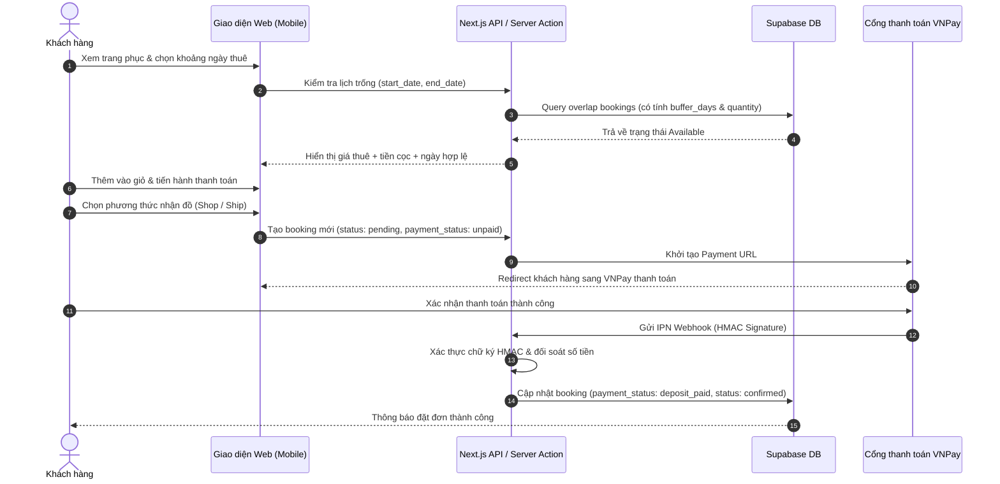
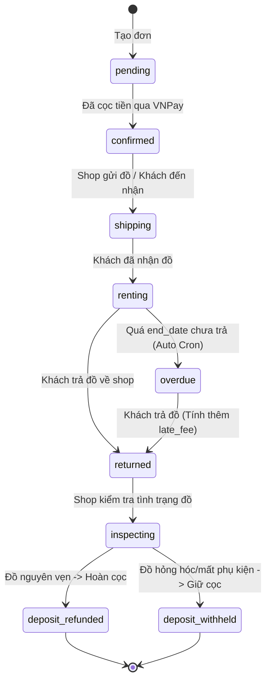
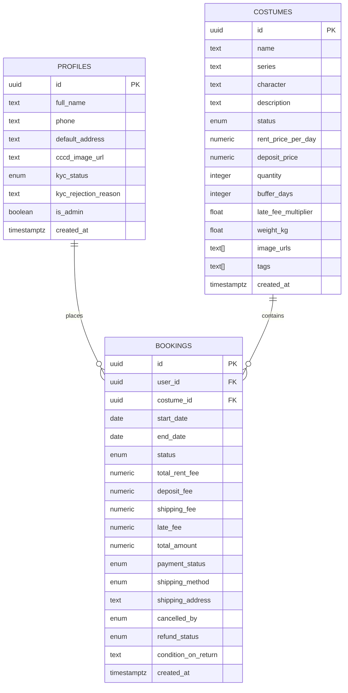

# Product Requirements Document (PRD) — Cosplay Rental Web App

## 1. Product Overview
**Cosplay Rental Web App** là nền tảng thương mại điện tử chuyên biệt dành cho dịch vụ cho thuê trang phục, tóc giả (wig), và đạo cụ (props) cosplay, biểu diễn nghệ thuật, và sự kiện lễ hội tại Việt Nam. 
Nền tảng giải quyết bài toán:
- Tối ưu chi phí cho cộng đồng cosplayer và người tham gia sự kiện thay vì phải mua trang phục đắt đỏ chỉ mặc 1-2 lần.
- Đảm bảo tính sẵn sàng thông qua cơ chế kiểm tra lịch trống (Calendar Date Range) thông minh chống trùng lịch (double booking) và tự động tính ngày đệm (buffer days).
- Tách bạch minh bạch giữa tiền thuê và tiền cọc (deposit), hỗ trợ thanh toán bảo chứng an toàn qua VNPay/Momo, cùng quy trình xác thực danh tính KYC (CCCD) bảo vệ chủ cửa hàng.

---

## 2. Goals & Objectives
- **Primary Goal:** Cung cấp trải nghiệm đặt thuê trang phục mượt mà, trực quan trên thiết bị di động (Mobile-First), loại bỏ hoàn toàn tình trạng trùng lịch và tranh chấp tiền cọc.
- **Success Metrics:**
  - 100% các đơn đặt hàng được tự động xác minh tính khả dụng của trang phục theo ngày.
  - Tỷ lệ hoàn cọc đúng hẹn và minh bạch đạt >98%.
  - Thời gian hoàn tất quy trình đặt đồ và thanh toán cọc < 3 phút trên điện thoại.
- **Key Differentiators:**
  - Lịch chọn ngày trực quan (Interactive Calendar Picker) hiển thị trạng thái ngày trống/kín.
  - Thuật toán quản lý đa phiên bản (`quantity > 1`) và tự động cộng dồn ngày đệm giặt ủi (`buffer_days` khi `quantity = 1`).
  - Tích hợp cổng thanh toán VNPay có Webhook IPN kiểm tra chữ ký HMAC an toàn.

---

## 3. Target Users & Personas
1. **Cosplayer nghiệp dư & chuyên nghiệp (Gen Z / Gen Y, 16 - 28 tuổi):**
   - *Nhu cầu:* Muốn hóa thân thành các nhân vật anime/manga/game yêu thích trong các festival (Comic Con, Fes trường) với chi phí hợp lý.
   - *Pain point:* Mua đồ đắt, tự may mất thời gian; thuê ngoài hay bị trễ hẹn, đồ cũ hỏng hoặc bị trừ cọc vô lý.
2. **Photographer & Media Producer:**
   - *Nhu cầu:* Cần đạo cụ và trang phục chất lượng cao cho các buổi chụp ảnh concept hoặc quay MV/TVC ngắn ngày.
   - *Pain point:* Cần biết chính xác ngày có thể lấy đồ và ngày trả đồ để khớp lịch quay/chụp.
3. **Chủ cửa hàng / Quản trị viên (Shop Admin):**
   - *Nhu cầu:* Quản lý kho đồ, số lượng bản sao, tình trạng giặt ủi/sửa chữa, theo dõi duyệt KYC CCCD khách hàng và quyết định hoàn/giữ cọc.

---

## 4. Features & Requirements

### Core Features (MVP)
- [x] **Product Catalog & Search:**
  - Duyệt danh sách trang phục theo Series (Genshin, Honkai, Anime...), Nhân vật, Tag (Mới, Hot).
  - Tìm kiếm theo tên hoặc phụ kiện đi kèm.
- [x] **Interactive Calendar Range Picker:**
  - Chọn ngày bắt đầu (`start_date`) và kết thúc (`end_date`).
  - Vô hiệu hóa ngày trong quá khứ và các ngày đã có người đặt thuê.
  - Tự động tính tổng số ngày và tiền thuê (`rent_price_per_day * days`).
- [x] **Transparent Deposit & Pricing Engine:**
  - Tách bạch trường `total_rent_fee` và `deposit_fee`.
  - Hỗ trợ tính phí vận chuyển theo trọng lượng hoặc tự lấy đồ tại shop (`self_pickup`).
- [x] **Payment Gateway & Webhook (VNPay):**
  - Tích hợp tạo URL thanh toán và Webhook IPN tại `/api/payment/webhook`.
  - Xác thực chữ ký HMAC SHA512 đảm bảo chống giả mạo giao dịch.
- [x] **User KYC Verification:**
  - Upload ảnh CCCD/CMND vào Supabase Private Storage.
  - Quản lý trạng thái KYC: `unsubmitted` → `pending` → `verified` | `rejected`.
- [x] **Admin Operations Dashboard:**
  - Quản lý CRUD sản phẩm kèm `quantity`, `buffer_days`, `late_fee_multiplier`.
  - Quản lý đơn thuê: Duyệt đơn, cập nhật trạng thái (`shipping` → `renting` → `returned` → `inspecting`).
  - Quyết định giải ngân tiền cọc (`deposit_refunded`) hoặc giữ cọc bồi thường (`deposit_withheld`).
  - Kiểm tra các đơn quá hạn trả (`overdue`) và tự động tính phí phạt trễ hạn.
- [x] **Password Security Standards & Real-time Meter:**
  - Quy chuẩn mật khẩu an toàn: Tối thiểu 8 ký tự, ít nhất 1 chữ hoa, 1 chữ thường, 1 chữ số.
  - Áp dụng đồng bộ cho Đăng ký (`/register`), Đổi mật khẩu (`/profile`), API Backend và Zod Schema.
  - Password Strength Meter và Checklist thời gian thực hỗ trợ UX thân thiện.

### Nice-to-Have (Post-MVP)
- [ ] Gợi ý combo phụ kiện (Wig styling, vũ khí cosplay, giày).
- [ ] Tích hợp chat trực tiếp giữa khách hàng và Admin để tư vấn size đồ.
- [ ] Đánh giá và feedback ảnh khách hàng mặc đồ thực tế (Lookbook).

---

## 5. User Flows

### 5.1. Customer Booking Flow


### 5.2. Return & Deposit Refund Flow


---

## 6. Wireframes (Mobile-First Architecture)

### 6.1. Mobile Layout & Bottom Navigation Bar
```
┌────────────────────────────────────────┐
│ [Logo] CosRent            [🔍] [🛒 (2)]│
├────────────────────────────────────────┤
│                                        │
│   ✨ KHÁM PHÁ TRANG PHỤC HOT           │
│   ┌────────────────────────────────┐   │
│   │ [Banner: Fes Mùa Hè 2026]      │   │
│   └────────────────────────────────┘   │
│                                        │
│   DANH MỤC: [Tất cả] [Genshin] [Anime] │
│                                        │
│   ┌──────────────┐  ┌──────────────┐   │
│   │ [ Ảnh đồ 1 ] │  │ [ Ảnh đồ 2 ] │   │
│   │ Raiden Shogun│  │ Frieren      │   │
│   │ 150k/ngày    │  │ 120k/ngày    │   │
│   │ Cọc: 500k    │  │ Cọc: 400k    │   │
│   └──────────────┘  └──────────────┘   │
│                                        │
├────────────────────────────────────────┤
│ [🏠 Trang chủ] [🔍 Khám phá] [👤 Tôi]  │
└────────────────────────────────────────┘
```

### 6.2. Product Detail with Calendar Date Picker
```
┌────────────────────────────────────────┐
│ [< Quay lại]              [Chia sẻ]    │
├────────────────────────────────────────┤
│ [  Ảnh trang phục vuốt ngang (1/5)   ] │
│                                        │
│ Raiden Shogun - Genshin Impact         │
│ 150.000 đ/ngày  •  Cọc: 500.000 đ      │
│ Tình trạng: Sẵn sàng (Kho: 2 bộ)       │
├────────────────────────────────────────┤
│ CHỌN NGÀY THUÊ:                        │
│ ┌────────────────────────────────────┐ │
│ │  Tháng 10 / 2026                   │ │
│ │  T2  T3  T4  T5  T6  T7  CN        │ │
│ │  ..  ..   1   2  [3   4   5] (Thuê)│ │
│ │  [6] (Buffer) 8   9  10  11  12    │ │
│ └────────────────────────────────────┘ │
│ Dự kiến: 3 ngày (03/10 -> 05/10/2026)  │
│ Tiền thuê: 450.000 đ                   │
│ Tiền cọc:  500.000 đ (Hoàn khi trả đồ) │
├────────────────────────────────────────┤
│ [  THÊM VÀO GIỎ HÀNG / ĐẶT NGAY  ]     │
└────────────────────────────────────────┘
```

---

## 7. Data Models & Entity Relationship



---

## 8. Technical Architecture

### 8.1. Tech Stack
- **Framework:** Next.js 15 (App Router, Server Actions, Route Handlers)
- **Language:** TypeScript 5.x strict mode
- **Styling:** Tailwind CSS (Mobile-First responsive utility classes)
- **Database & Auth:** Supabase PostgreSQL with Row Level Security (RLS) policies & DB Triggers
- **State Management:** Zustand (Client-side Cart & Session state)
- **Validation:** Zod schemas
- **Payment:** VNPay Payment Gateway with HMAC-SHA512 Verification

### 8.2. Docker Infrastructure (`docker-compose.yml`)
Hỗ trợ Docker-First cho phát triển local độc lập:
- Service `postgres:16-alpine`: Chạy database PostgreSQL tương thích schema Supabase.
- Service `redis:7-alpine`: Dùng để quản lý session và cache lịch trống nếu mở rộng.
