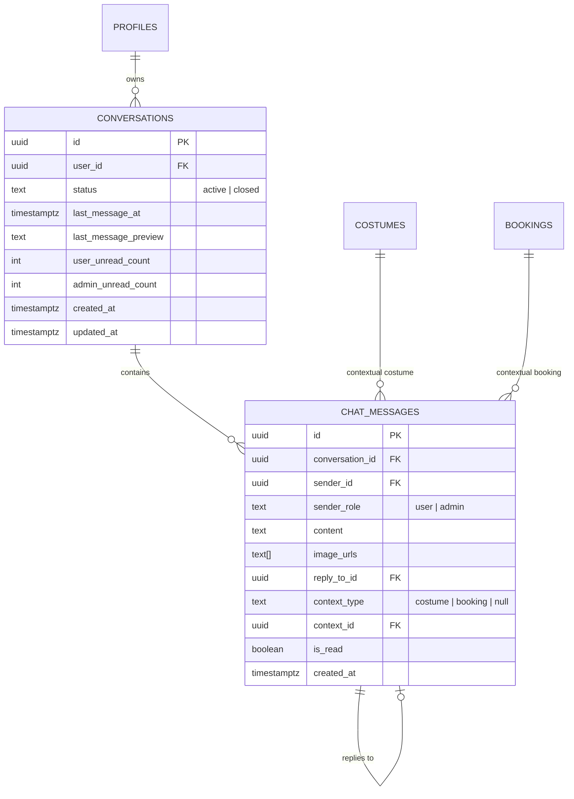

# ĐẶC TẢ THIẾT KẾ KỸ THUẬT: HỘP CHAT THỜI GIAN THỰC (REALTIME CHAT SYSTEM)
**Dự án:** Cosplay Rental Web App (CosRent)  
**Ngày thiết kế:** 2026-10-11  
**Trạng thái:** Chờ phê duyệt (Pending Approval)  
**Tài liệu hợp nhất:** [Claude.md](file:///d:/Work/Cos-app/Claude.md)  

---

## 1. TỔNG QUAN & MỤC TIÊU (OVERVIEW & GOALS)

### 1.1. Bối cảnh & Vấn đề
Khách thuê trang phục cosplay thường có nhu cầu tư vấn rất cao trước và sau khi đặt hàng:
- Tư vấn số đo cơ thể (vòng ngực, eo, chiều cao), độ vừa vặn của trang phục, tình trạng tóc giả (wig) và đạo cụ đính kèm trước khi quyết định đặt.
- Trao đổi nhanh về tình trạng chuẩn bị đồ, thời gian gửi hàng và giải đáp thắc mắc liên quan đến mã vận đơn / thời điểm nhận đồ.

### 1.2. Mục tiêu thiết kế
- Cung cấp hệ thống chat trực tuyến thời gian thực (Realtime Chat) hai chiều giữa Khách hàng (User đã đăng nhập) và Quản trị viên (Shop Admin).
- Trải nghiệm giao diện (UI/UX) lấy cảm hứng từ Facebook Messenger: bong bóng chat nổi, tin nhắn phân 2 vế, trả lời trích dẫn (Quote Reply), gửi ảnh sắc nét nhưng nén tự động WebP để tối ưu dung lượng, và xem ảnh phóng to toàn màn hình (Lightbox).
- Tích hợp sâu vào các điểm chạm mua sắm: Nút "Trò chuyện về trang phục này" ở trang chi tiết sản phẩm và nút "Hỏi về đơn hàng" ở trang theo dõi đơn hàng.
- Cung cấp công cụ quản lý chat chuyên nghiệp cho Admin: 2 cột kiểu Messenger Web, tìm kiếm, lọc hội thoại Đang mở / Đã lưu trữ (Archive/Closed).

---

## 2. KIẾN TRÚC HỆ THỐNG & CÔNG NGHỆ (ARCHITECTURE & TECH STACK)

- **Frontend:** Next.js 15 App Router, React 19, TypeScript strict mode.
- **Styling:** Tailwind CSS, hỗ trợ 2 chế độ màu (Dark Mode mận đen huyền bí & Light Mode Sakura Pastel hoa anh đào).
- **Database & Auth:** Supabase PostgreSQL với Row Level Security (RLS) bảo vệ đa tầng.
- **Realtime Engine:** Supabase Realtime Channels (lắng nghe sự kiện `INSERT` trên bảng `chat_messages` qua PostgreSQL Changes).
- **Storage:** Supabase Storage Bucket `chat-attachments` lưu trữ ảnh nén.
- **Image Compression:** HTML5 Canvas chuyển đổi sang định dạng WebP (chất lượng 82%, cạnh dài tối đa 1920px), nén trực tiếp trên trình duyệt người dùng trước khi gửi lên Supabase Storage.
- **Notification Integration:** Tự động tạo bản ghi trong bảng `notifications` hiện có khi Admin nhắn tin mới cho User.

---

## 3. MÔ HÌNH DỮ LIỆU & PHÂN QUYỀN (DATABASE MODELS & RLS)

### 3.1. Sơ đồ Quan hệ Thực thể (ERD)


### 3.2. Chi tiết Bảng & Migration (`015_realtime_chat.sql`)
1. **Bảng `conversations`:**
   - Quản lý phiên làm việc giữa 1 Khách hàng và Shop.
   - `status`: `'active'` (đang trao đổi) hoặc `'closed'` (Admin đã lưu trữ phiên). Khi ở trạng thái `closed`, hai bên chỉ có thể xem lại tin nhắn cũ; Khách hàng có nút *"Bắt đầu phiên hỗ trợ mới"* để tạo bản ghi conversation `active` mới.
2. **Bảng `chat_messages`:**
   - Quản lý nội dung tin nhắn, liên kết ảnh, trích dẫn tin nhắn (`reply_to_id`), và thẻ ngữ cảnh đính kèm (`context_type`, `context_id`).
3. **Cấu hình Supabase Realtime:**
   ```sql
   ALTER PUBLICATION supabase_realtime ADD TABLE public.chat_messages;
   ALTER PUBLICATION supabase_realtime ADD TABLE public.conversations;
   ```
4. **Row Level Security (RLS):**
   - User chỉ được xem/gửi tin nhắn thuộc `conversations` có `user_id = auth.uid()`.
   - Admin (`is_admin = TRUE` trên `profiles`) có toàn quyền xem và gửi tin nhắn trong mọi cuộc trò chuyện, đồng thời có quyền đổi `status` thành `'closed'`.

---

## 4. THIẾT KẾ GIAO DIỆN & TƯƠNG TÁC (UI/UX SPECIFICATION)

### 4.1. Phía Khách hàng (User Experience)
- **Bong bóng chat nổi (Floating Chat Bubble):**
  - Vị trí: Góc dưới bên phải (Bottom-Right), `fixed z-50`.
  - Icon hoa anh đào gradient (`from-pink-500 to-rose-400`), badge số tin nhắn chưa đọc đỏ nổi bật có hiệu ứng Pulse.
  - Khi click: Mở khung chat popup 380×520px trên PC, hoặc Fullscreen Drawer trên Mobile.
- **Thanh nhập liệu (Chat Input Area):**
  - Input tự co giãn chiều cao theo nội dung văn bản.
  - Nút đính kèm ảnh (tối đa 3 ảnh/tin), hiện thumbnail xem trước có nút xóa từng ảnh.
  - Phím `Enter` gửi tin, `Shift + Enter` xuống dòng.
- **Đính kèm Ngữ cảnh tự động (Context Cards):**
  - Mở từ trang chi tiết trang phục `/products/[id]`: Tự ghim card trang phục (ảnh đại diện, tên nhân vật, bộ truyện, giá thuê).
  - Mở từ trang theo dõi đơn `/profile/bookings`: Tự ghim card đơn hàng (mã đơn, tổng tiền, trạng thái giao vận).
- **Quote Reply (Trích dẫn tin nhắn):**
  - PC: Hover lên tin nhắn hiện nút Reply cong.
  - Mobile: Tap vào tin nhắn hiện thanh công cụ reply.
  - Ghim thanh "Đang trả lời [Người gửi]" phía trên ô chat có nút hủy `✕`.
  - Khối tin nhắn trả lời có trích dẫn thu nhỏ; khi click vào sẽ tự cuộn mượt (Smooth Scroll) và nháy sáng viền tin nhắn gốc.
- **Phóng to ảnh (Lightbox):**
  - Click vào ảnh bất kỳ trong tin nhắn sẽ mở Lightbox toàn màn hình, xem rõ từng chi tiết phụ kiện cosplay.

### 4.2. Phía Quản trị viên (Admin Chat Studio)
- Tích hợp tại Admin Dashboard (Tab "Tin nhắn & Tư vấn" hoặc đường dẫn `/admin/messages`).
- Giao diện 2 cột chuẩn Messenger Web:
  - **Cột trái (320px):** Danh sách khách hàng, ô tìm kiếm tên/SĐT, phân loại 2 tab "Đang hoạt động" và "Đã lưu trữ", huy hiệu tin chưa đọc.
  - **Cột phải (Khung chat chính):** Header hiển thị tên khách, avatar, trạng thái KYC, nút xem nhanh hồ sơ/lịch sử đơn hàng, nút "Lưu trữ cuộc trò chuyện (Đóng phiên)".

---

## 5. HỆ THỐNG BẢNG KIỂM THỬ (TESTCASE SPECIFICATION)

Bảng phân loại chi tiết các ca kiểm thử cho chức năng Realtime Chat:

| Testcase ID | Hạng mục (Category) | Mô tả Ca kiểm thử (Test Description) | Điều kiện tiên quyết (Preconditions) | Các bước thực hiện (Steps) | Kết quả mong đợi (Expected Results) | Mức độ ưu tiên |
| :--- | :--- | :--- | :--- | :--- | :--- | :---: |
| **TC-CHAT-01** | Khởi tạo hội thoại | Khách hàng đã login bấm nút chat từ trang sản phẩm | User đã đăng nhập, đang ở trang `/products/[id]` | 1. Bấm nút "Trò chuyện thêm về sản phẩm"<br>2. Nhập tin nhắn và bấm Gửi | Hộp chat mở ra, Thẻ ngữ cảnh sản phẩm (Costume Card) được gửi kèm tin nhắn, Admin nhận được tin nhắn và card ngay lập tức. | **P0** (Bắt buộc) |
| **TC-CHAT-02** | Khởi tạo hội thoại | Khách hàng bấm nút chat từ trang theo dõi đơn hàng | User có đơn hàng trong `/profile/bookings` | 1. Bấm nút "Hỏi shop về đơn hàng"<br>2. Nhập tin nhắn hỏi | Hộp chat hiển thị thẻ mã đơn hàng đính kèm, Admin click vào thẻ xem được chi tiết đơn. | **P0** (Bắt buộc) |
| **TC-CHAT-03** | Khách vãng lai | Khách chưa đăng nhập bấm nút chat | Người dùng chưa đăng nhập (Guest) | Bấm vào bong bóng chat hoặc nút chat tại trang chi tiết sản phẩm | Hiển thị Toast thông báo yêu cầu đăng nhập, điều hướng sang trang login kèm redirect URL. | **P1** |
| **TC-CHAT-04** | Đồng bộ Realtime | Nhắn tin 2 chiều tức thì giữa User và Admin | Mở đồng thời 2 trình duyệt (1 User, 1 Admin) | 1. User gửi tin nhắn văn bản<br>2. Admin gửi tin nhắn trả lời | Tin nhắn xuất hiện tức thì ở cả 2 màn hình (< 200ms) mà không cần reload trang. | **P0** (Bắt buộc) |
| **TC-CHAT-05** | Quote Reply | Thao tác trả lời trích dẫn tin nhắn trên PC | Có sẵn ít nhất 2 tin nhắn trong hội thoại | 1. Rê chuột (Hover) lên tin nhắn đối phương<br>2. Click icon Reply<br>3. Gõ câu trả lời và gửi | Xuất hiện thanh trích dẫn trên ô chat. Tin gửi đi có khối trích dẫn tin gốc. Click vào khối trích dẫn thì khung chat tự cuộn tới tin gốc và nháy sáng viền. | **P0** (Bắt buộc) |
| **TC-CHAT-06** | Quote Reply | Thao tác trả lời trích dẫn tin nhắn trên Mobile | Mở giao diện trên thiết bị di động | 1. Chạm (Tap) vào tin nhắn<br>2. Chọn biểu tượng Reply<br>3. Gửi tin | Tương tự TC-CHAT-05, trích dẫn chính xác nội dung tin gốc. | **P1** |
| **TC-CHAT-07** | Nén & Gửi ảnh | Gửi từ 1 đến 3 ảnh dung lượng lớn (> 5MB/ảnh) | Có sẵn file ảnh chụp độ phân giải cao | 1. Chọn 3 ảnh đính kèm<br>2. Xem thumbnail preview<br>3. Bấm Gửi | Ảnh được nén tự động sang WebP (< 600KB), tải lên bucket `chat-attachments`, hiển thị mượt mà trên khung chat cả 2 bên. | **P0** (Bắt buộc) |
| **TC-CHAT-08** | Lightbox Phóng to | Xem ảnh toàn màn hình trong khung chat | Tin nhắn đã có ảnh gửi thành công | Click vào bất kỳ ảnh nào trong bong bóng chat | Mở Lightbox xem ảnh kích thước đầy đủ với nền đen mờ, đóng được bằng nút ✕ hoặc phím Esc. | **P1** |
| **TC-CHAT-09** | Lưu trữ (Archive) | Admin lưu trữ cuộc trò chuyện đã xong | Cuộc trò chuyện đang ở trạng thái `active` | 1. Admin bấm menu "Lưu trữ cuộc trò chuyện"<br>2. Xác nhận | Cuộc hội thoại chuyển sang trạng thái `closed`, chuyển vào tab "Đã lưu trữ" của Admin. User thấy thông báo phiên đóng và có nút "Bắt đầu phiên mới". | **P0** (Bắt buộc) |
| **TC-CHAT-10** | Tạo phiên mới | User tạo phiên mới sau khi phiên cũ đã đóng | Cuộc trò chuyện trước đó đã `closed` | User bấm "Bắt đầu phiên hỗ trợ mới" | Hệ thống tạo conversation `active` mới, lịch sử cũ vẫn được lưu trữ tra cứu. | **P1** |
| **TC-CHAT-11** | Thông báo & Âm thanh | Nhận tin nhắn mới khi đang thu nhỏ chat | User hoặc Admin đang đóng khung chat | Đối phương gửi 1 tin nhắn mới | Bong bóng chat cập nhật huy hiệu đếm số tin chưa đọc, chuông thông báo Header hiện thông báo mới, phát âm thanh ting nhẹ. | **P1** |
| **TC-CHAT-12** | Responsive & Theme | Kiểm tra hiển thị đa thiết bị và chuyển Theme | Trình duyệt hỗ trợ toggle Dark/Light | 1. Đổi giữa Light Mode và Dark Mode<br>2. Thu nhỏ màn hình từ PC sang Mobile | Bong bóng chat, màu nền, độ tương phản chữ và hình ảnh hiển thị rõ ràng, không bị lỗi vỡ layout hoặc chìm màu chữ. | **P1** |
| **TC-CHAT-13** | Xử lý file lỗi | Người dùng cố tình tải lên file không phải ảnh (PDF/EXE) | Chọn file không hợp lệ | Chọn file văn bản PDF trong ô tải ảnh | Hiển thị Toast cảnh báo từ chối file, không thực hiện nén hay upload lên server. | **P2** |

---

## 6. QUY TRÌNH TRIỂN KHAI TIẾP THEO
1. Người dùng duyệt và thống nhất bản đặc tả thiết kế này.
2. Chuyển sang kỹ năng `writing-plans` để lập kế hoạch triển khai từng bước chi tiết (`IMPLEMENTATION_PLAN.md`).
3. Cập nhật đồng bộ các thay đổi vào tài liệu chính thống [Claude.md](file:///d:/Work/Cos-app/Claude.md).
